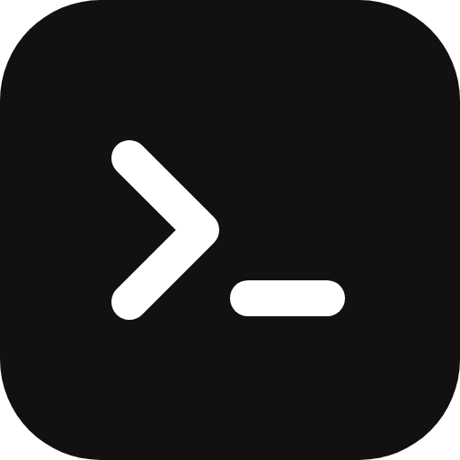

<p align="center"></p>

# grok-bot-agents

A skills-only Grok Bot plugin that installs, signs in and drives **Claude Code, Codex CLI, Pi and
omp (Oh My Pi)** on the Grok Bot box (the bot's cloud computer).

Grok Bot keeps light work for itself and hands **heavy work, coding or not,** to a CLI agent:
research and analysis, data and file processing, bulk transforms, long drafts and translations, log
analysis, long or unattended jobs. You can name the CLI ("have codex fix this") or let the bot route
by cost and difficulty. Runs are headless and isolated, and come back as a short summary plus
artifact paths.

한국어: [README.ko.md](README.ko.md) · UX walkthrough: [`docs/ux-flow.html`](docs/ux-flow.html) ([PNG](docs/ux-flow.png))

## Skills

| Skill | What it does |
|---|---|
| `setup-agents` | Pick CLIs (multi-select), install only those, sign in (subscription takeover, API key via masked input, or import), choose default model/reasoning, write the config, run an OK test per CLI |
| `import-agents` | Copy existing CLI logins and settings from your registered computer to the box, file by file, with an allowlist and your approval for each copy |
| `configure-agents` | Change models, reasoning, permission mode, routing, logins/keys and each CLI's native config |
| `delegate-task` | Decide light vs heavy, route to a CLI (or the one you named), write a standalone brief, run it headless, report back. Includes read-only code review |
| `agent-bridge-webhook` | Two-way handoff with agents on another machine or CI through a webhook routine; answers stream back to the caller's terminal over Tailscale (`grok-send-task --wait`), with sanitizing in both directions |

## Flow

1. **Install** the plugin from the Cursor marketplace (Settings → plugins in Grok Bot).
2. **Set up** (`/setup-agents`): choose CLIs, sign in, pick models. API keys go through masked input
   or `~/.agent-keys` (mode 600), **never into chat**. Model and reasoning default to **native**: no
   flag is passed and each CLI's own (or imported) settings apply.
3. **Delegate** (`/delegate-task`): "have pi translate the README", "analyze this log folder", "fix this bug".
4. **Change settings** (`/configure-agents`): "set claude reasoning to max", "turn off omp".

## Light vs heavy

A task is heavy if **any** of these hold; otherwise the bot does it itself:
- about 5+ files, or a whole repo or folder
- about 50 KB+ of input (big logs, CSV/JSON, long PDFs)
- about 10+ tool or shell steps, or a run → check → fix loop
- 5+ minutes, unattended or overnight, or a recurring routine
- token-heavy bulk generation

## Routing

`scripts/route.py decide` applies the rules, the config and the rate-limit state:

| Heavy-work type | First choice | Fallback |
|---|---|---|
| Bulk / repetitive / token-heavy | `routing.cheap` (Pi, then omp) | a frontier agent |
| Long or unattended | omp | Claude Code / Codex |
| Hard reasoning, final code, nuanced writing | `routing.hard` (Claude Code, then Codex) | omp / Pi, strongest model |
| Review / second opinion | the frontier agent that didn't produce it | cheap agent, read-only |

A named CLI always wins (or the bot asks if it's unavailable). When a run hits a subscription or rate
limit, the runner records the reset time in `~/.grok-bot-agents/state.json` and the router skips that CLI
until then.

## Isolation

- **git repo**: every run gets its own worktree and branch `agent/<run-id>`. A rate-limited run that
  changed nothing removes its own worktree.
- **no repo / non-coding**: runs in `/workspace/agent-runs/<run-id>/work`; inputs are added read-only
  with `--input`.
- **review**: `--review DIR` runs read-only in place with a generated `review.diff` (uncommitted and
  untracked files included). A before/after fingerprint fails the run if anything changed.

## Permission modes

| | full-auto (default) | safe | read-only |
|---|---|---|---|
| Codex | `--dangerously-bypass-approvals-and-sandbox` | `-s workspace-write` | `-s read-only` |
| Claude Code | `--permission-mode bypassPermissions` | `acceptEdits` | `plan` |
| omp | `--approval-mode yolo` | `--approval-mode write` | `write` + `--tools read,grep,glob` |
| Pi | no approval system | same | `--tools read,grep,find,ls` |

Push, merge, PR, deploy, publishing and sending messages always need your OK, even in full-auto.
Full-auto gives the agent unrestricted shell, network and login-session access on the box. Worktrees
isolate files, not the system.

## Config: `~/.grok-bot-agents/config.json`

Shared by every bot on the box. Keys are never stored, only env var names (`key_env`).

```json
{
  "version": 1,
  "enabled": ["claude", "codex", "pi"],
  "permission_mode": "full-auto",
  "worktree_per_task": true,
  "timeout_sec": 1800,
  "agents": {
    "claude": {"auth": "oauth", "model": null, "reasoning": null},
    "codex":  {"auth": "imported", "model": "native", "reasoning": "native"},
    "pi":     {"auth": "api_key", "key_env": "DEEPSEEK_API_KEY", "model": "deepseek/<model-id>", "reasoning": "low"},
    "omp":    {"auth": "imported", "model": "native", "reasoning": "native"}
  },
  "routing": {"mode": "auto", "cheap": ["pi", "omp"], "hard": ["claude", "codex"], "review": "other-frontier", "prefer": [], "fixed": null},
  "runs_dir": "/workspace/agent-runs"
}
```

## Importing from your computer

| CLI | Imported | Notes |
|---|---|---|
| Codex | `~/.codex/auth.json`, `config.toml`, `AGENTS.md`, `prompts/`, `skills/` | `codex login status` only checks the file; a real OK run confirms it |
| Claude Code | `~/.claude/.credentials.json`, `settings.json`, `CLAUDE.md`, `agents/`, `commands/`, `skills/`, `mcpServers` from `~/.claude.json` | On macOS the login is in the Keychain and can't be copied: sign in on the box instead |
| Pi | `~/.pi/agent/auth.json`, `anthropic-auth.json`, `settings.json`, `models.json` (+ `AGENTS.md`, `prompts/`, `skills/`, `extensions/`) | Needs `@earendil-works/pi-coding-agent` (Node ≥ 22.19) |
| omp | `~/.omp/agent/agent.db`, `config.yml`, `models.yml`, `mcp.json` | Quit omp first; `-wal`/`-shm` come along |

Symlinked skill folders are bundled with `import_plan.py --dereference` (a `tar -h` tarball) and
staged with `stage_tar.py`. Sessions, history, logs, caches, SSH keys and unrelated dotfiles are never
imported. Sharing one OAuth login across two machines can log one of them out when the token refreshes.

## Answers back in your terminal (Tailscale)

`grok-send-task --wait "task"` on your Mac (or inside Claude Code / Codex) streams progress and prints the answer in the
same terminal, over your tailnet. The bot sets it all up: `setup-tailscale.sh` installs Tailscale on the box (no root,
sha256-checked static build), starts it in userspace mode, and prints a login link. You approve that link, the bot waits
(`--wait-login`), then hands the return-channel token to your machine without showing it in chat. Your machine needs
Tailscale on the same account; `grok-send-task --check` tells you if it's missing (`brew install --cask tailscale`).

```bash
setup-tailscale.sh                 # install/start/login if needed → STATUS=ready | needs_login (+ LOGIN_URL=…)
setup-tailscale.sh --wait-login    # block until the login is approved (default 300 s)
setup-tailscale.sh --status        # TAILNET_IP, DNS_NAME, RESULT_URL, STATUS
setup-tailscale.sh --uninstall [--purge] [--dry-run]
```

## Layout

```
.cursor-plugin/plugin.json
assets/logo.svg, logo.png
docs/ux-flow.html, ux-flow.png
skills/
  setup-agents/SKILL.md
  import-agents/       SKILL.md, scripts/{import_plan.py, stage_tar.py, apply_import.sh}
  configure-agents/    SKILL.md, scripts/agents_config.py
  delegate-task/       SKILL.md, scripts/{run-agent.sh, route.py, summarize_run.py}, references/
  agent-bridge-webhook/ SKILL.md, scripts/{bridge.py, bridge_server.py, bridge-serve.sh, setup-tailscale.sh, sanitize_result.py, send-task.sh, bridge.env.example}
```

## Testing and release

See [TESTING.md](TESTING.md) for the checks and the end-to-end matrix, and [CHANGELOG.md](CHANGELOG.md).
To publish: push to a public GitHub repo, submit at https://cursor.com/marketplace/publish and tick
Grok Bot as a target.

## Open questions

- Whether `minClientVersions` needs a Grok Bot key
- Whether the app's multi-select card and masked secret input work from plugin skills
- Whether cross-skill relative paths (`../configure-agents/scripts/...`) hold in an installed plugin
- Claude Code end-to-end on a non-rate-limited account (Codex, Pi and omp are verified)

## License

MIT © AgwaB
